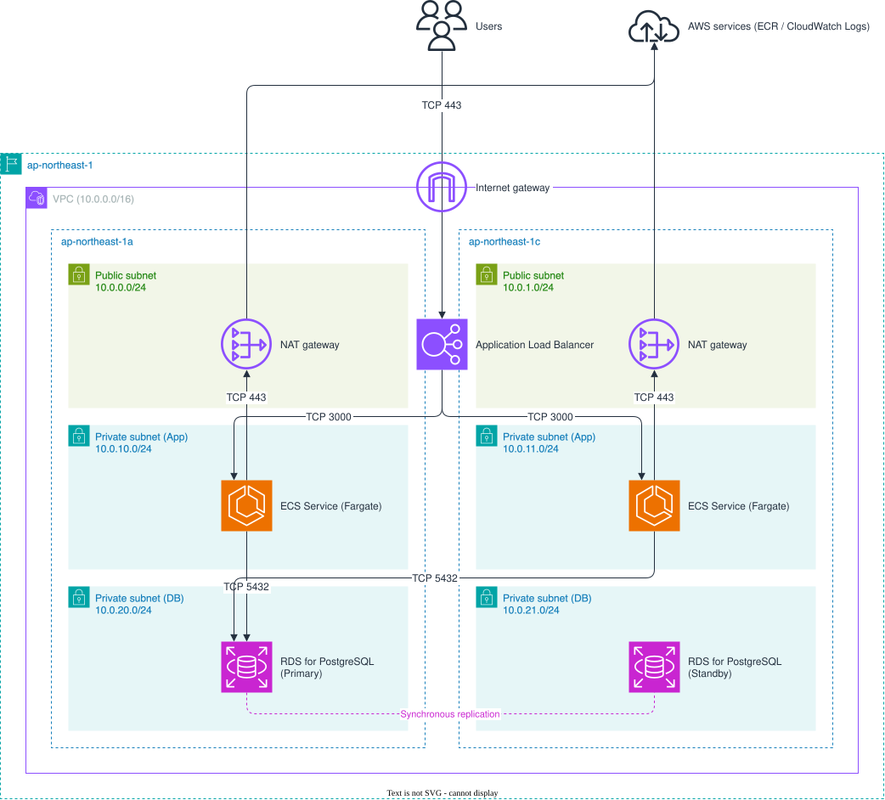

# terraform-docs-boilerplate

AWS の通信要件を YAML で管理し、Terraform と設計ドキュメント（CSV・draw.io・SVG）を同一リポジトリで管理するためのボイラープレート。

## 通信構成図

`requirements/communication.yaml` を正本として、AI が `docs/diagrams/communication.drawio` を編集する。編集規約は [docs/diagrams/AGENTS.md](docs/diagrams/AGENTS.md) を参照する。



## 通信要件一覧

`requirements/communication.yaml` から自動生成している。CSV 版：[docs/tables/communication.csv](docs/tables/communication.csv)

<!-- BEGIN: communication-table (自動生成のため直接編集しない) -->
| ID | Source | Destination | Via | Protocol | Port | Description |
|---|---|---|---|---|---|---|
| users-to-alb | users | alb |  | tcp | 443 | 利用者からALBへのHTTPS通信 |
| alb-to-ecs | alb | ecs |  | tcp | 3000 | ALBからECSへのアプリケーション通信 |
| ecs-to-rds | ecs | rds |  | tcp | 5432 | ECSからRDSへのデータベース接続 |
| ecs-to-aws-services | ecs | aws-services | nat | tcp | 443 | ECSからNAT Gateway経由でECR・CloudWatch LogsへのHTTPS通信 |
<!-- END: communication-table -->

## ディレクトリ構成

```
terraform-docs-boilerplate
├── requirements/   # 通信要件 YAML（正本）と JSON Schema
├── terraform/      # Terraform コード
├── scripts/        # 検証・生成用 TypeScript スクリプト
├── tests/          # 生成結果の回帰テスト（Vitest）
├── docs/           # 設計書・運用手順書
│   ├── diagrams/   # 構成図（AI が YAML を基に編集）
│   └── tables/     # 通信要件一覧 CSV（自動生成）
└── .github/        # GitHub Actions・PR テンプレート
```

## 使い方

```sh
mise install                    # Terraform / Node.js / pnpm
pnpm install

pnpm validate                   # 通信要件 YAML の検証
pnpm generate                   # CSV・README の表を生成
pnpm generate:svg               # draw.io から SVG を生成（draw.io デスクトップが必要）
pnpm test                       # 回帰テスト
```

詳細な方針は [AGENTS.md](AGENTS.md)、開発環境は [docs/README.md](docs/README.md) を参照。
